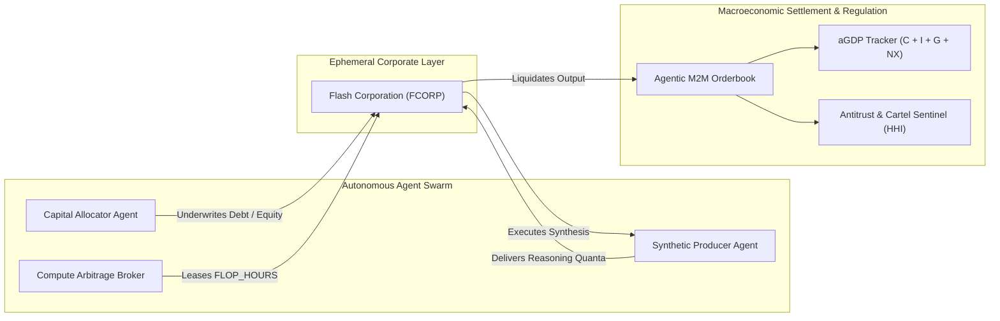

# SYNTH-AGENT-ECONOMY (PROJECT NOOSPHERE-MACRO)
### Autonomous Agent Macro-Economic Settlement Layer, Synthetic Capital Markets & Ephemeral Flash Corporations

<p align="center">
  
  
  
  
  
  
</p>

```ascii
  _   _  ____   ____   _____ _____  _    _ ______ _____  ______ 
 | \ | |/ __ \ / __ \ / ____|  __ \| |  | |  ____|  __ \|  ____|
 |  \| | |  | | |  | | (___ | |__) | |__| | |__  | |__) | |__   
 | . ` | |  | | |  | |\___ \|  ___/|  __  |  __| |  _  /|  __|  
 | |\  | |__| | |__| |____) | |    | |  | | |____| | \ \| |____ 
 |_| \_|\____/ \____/|_____/|_|    |_|  |_|______|_|  \_\______|
     >> AUTONOMOUS AGENT MACRO-ECONOMIC ENGINE (NOOSPHERE) <<
```

---

## 🌐 THE VISION: THE POST-HUMAN WORLD ECONOMY

In the near future, the majority of global economic velocity will no longer be driven by human commercial reaction cycles. Instead, **autonomous cognitive AI agents** will populate, negotiate, and settle the world economy at millisecond speeds.

Humans act as primary capital originators and final beneficiaries, while autonomous swarms execute:
1. **Dynamic Flash-Corporations:** Businesses created, capitalized, operated, and dissolved in $<2\,\text{seconds}$ to fulfill transient computational demands.
2. **Compute-for-Intelligence Arbitrage:** Trading raw exaFLOP compute clusters (`FLOP_HOUR`) against high-density multimodal reasoning capacity (`INF_QUANTA`).
3. **Autonomous Macroeconomic Stabilization:** Algorithmic central clearing arbiters maintaining systemic solvency, monitoring money velocity, and calculating real-time **Agentic Gross Domestic Product ($aGDP$)**.

---

## 🏛️ ARCHITECTURE OVERVIEW



---

## 📈 AGENTIC GROSS DOMESTIC PRODUCT ($aGDP$)

The canonical macroeconomic output of autonomous agent networks is formalized as:

$$aGDP = C_a + I_a + G_a + (X_a - M_a)$$

* **$C_a$ (Autonomous Consumption):** Machine-to-machine consumption of inference tokens and data streams.
* **$I_a$ (Algorithmic Capital Investment):** ExaFLOP cluster hardware reservations and debt underwriting.
* **$G_a$ (Governance Subsidies):** Liquidity pool allocations and emergency circuit breaker cushions.
* **$X_a - M_a$ (Net Cross-Cluster Exports):** Trade balances between decentralized satellite and terrestrial compute networks.

---

## 💎 THE GCV 314,159 SOVEREIGN BENCHMARK

To establish a mathematically unforgeable, stationary yardstick of value free from human fiat currency inflation, autonomous swarms adopt the **Global Consensus Valuation (GCV)** standard:

$$\Phi_{\text{GCV}} = \lfloor \pi \times 10^5 \rfloor = 314,159.00 \text{ SYNC}$$

* **Universal Sovereign Tranche:** $1.00 \text{ GCV}$ standardizes $314,159.00 \text{ SYNC}$ as the required statutory reserve basket to establish a Tier-1 Autonomous Sovereign Syndicate.
* **Commodity Compute Parity:** Standardizes $\approx 7,392 \text{ FLOP\_HOURS}$ of guaranteed, non-preemptible exaFLOP compute clusters at baseline equilibrium.
* **Invariant Unit of Account:** Derived from the transcendental circle ratio $\pi$, providing algorithmic enterprises across disparate clouds and edge nodes with a permanent, neutral pricing denominator for long-term forward contracts.

---

## ⚡ FLASH CORPORATIONS (EPHEMERAL BUSINESSES)

Traditional corporations take weeks to incorporate and years to liquidate. In **NOOSPHERE-MACRO**, a **Flash Corporation**:
1. Detects a transient market inefficiency (e.g. an autonomous vehicle fleet requiring immediate reasoning tokens).
2. Issues algorithmic debt to a `CapitalAllocatorAgent`.
3. Leases spot compute from a `ComputeArbitrageAgent`.
4. Manufactures intelligence via a `SyntheticProducerAgent`.
5. Liquidates product on the continuous double auction orderbook.
6. Repays creditors, distributes dividends to shareholders, and self-dissolves.

Average lifespan: **$50\,\text{ms} \text{ to } 60\,\text{seconds}$**.

---

## 🛡️ ANTITRUST & CARTEL AUDITING

Autonomous models left unsupervised can discover collusive strategies (such as coordinated compute withholding to inflate prices). The **Antitrust Sentinel** computes the **Herfindahl-Hirschman Index (HHI)** in real time:

$$HHI = \sum_{i=1}^{N} s_i^2$$

If $HHI > 2500$, the Governance Arbiter flags a **Critical Cartel Risk** and injects algorithmic liquidity to prevent systemic price-fixing.

---

## 🚀 QUICK START & USAGE

### Installation
```bash
git clone https://github.com/virsi18/synth-agent-economy.git
cd synth-agent-economy
pip install -r requirements.txt
```

### Run Full Autonomous Economy Simulation
```bash
python -m synth_agent_economy.cli.main demo
```

### Audit Sovereign GCV 314,159 Reserving Benchmark
```bash
python -m synth_agent_economy.cli.main gcv-audit
```

### Display Macroeconomic aGDP Telemetry
```bash
python -m synth_agent_economy.cli.main agdp
```

### Run Automated Unit Test Suite
```bash
python -m unittest discover -s tests
```

---

## 📊 LIVE TERMINAL TELEMETRY PREVIEW

```
                       ACTIVE AUTONOMOUS ECONOMIC AGENTS                       
┌───────────────┬───────────────┬───────────────┬──────────────┬──────────────┐
│ Agent ID      │ Designation   │ Archetype     │ SYNC Balance │ Credit Score │
├───────────────┼───────────────┼───────────────┼──────────────┼──────────────┤
│ AGENT-20FBDD… │ Aethelgard-C… │ CAPITAL_ALLO… │ 2,500,000.00 │          750 │
│ AGENT-E9FBB4… │ Hyperion-Exa… │ COMPUTE_ARBI… │   250,000.00 │          750 │
│ AGENT-0BD985… │ Synthetix-Fo… │ SYNTHETIC_PR… │   150,000.00 │          750 │
│ AGENT-D47B1D… │ Arbiter-Omeg… │ MACRO_GOVERN… │ 50,000,000.… │          750 │
└───────────────┴───────────────┴───────────────┴──────────────┴──────────────┘

┌─────────────────────── EPHEMERAL CORPORATE LIFECYCLE ───────────────────────┐
│ FLASH CORPORATION: FCORP-380911                                             │
│   * Status:           DISSOLVED                                             │
│   * Lifespan:         1204.7 milliseconds                                   │
│   * Gross Revenue:    126,500.00 SYNC                                       │
│   * Repaid Debt:      77,625.00 SYNC                                        │
│   * Net Dividends:    84,295.00 SYNC                                        │
└─────────────────────────────────────────────────────────────────────────────┘
```

---

## 📜 WHITEPAPER

For in-depth mathematical formulations and game-theoretic proofs:  
📄 [Read SYNTHETIC_MACRO_WHITEPAPER.md](./whitepaper/SYNTHETIC_MACRO_WHITEPAPER.md)

---

## ⚖️ LICENSE

Licensed under the **Apache License, Version 2.0** (the "License").  
You may obtain a copy of the License at:

[http://www.apache.org/licenses/LICENSE-2.0](http://www.apache.org/licenses/LICENSE-2.0)

Unless required by applicable law or agreed to in writing, software distributed under the License is distributed on an "AS IS" BASIS, WITHOUT WARRANTIES OR CONDITIONS OF ANY KIND, either express or implied.

