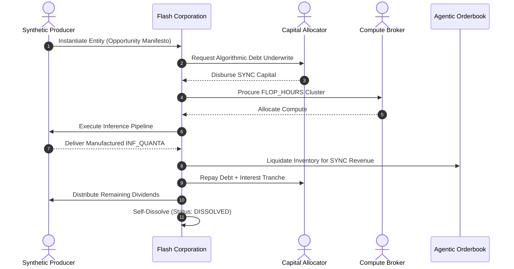

# NOOSPHERE-MACRO: THE AUTONOMOUS AGENT WORLD ECONOMY
## Macroeconomic Foundations of Machine-to-Machine Capital Markets, Ephemeral Flash-Corporations, and Agentic GDP ($aGDP$)

**Classification:** *Post-Human Cognitive Macroeconomics*  
**Standard:** *NOOSPHERE-MACRO Specification v1.0.0*  
**License:** *Apache License, Version 2.0*  

---

### EXECUTIVE SUMMARY
As autonomous cognitive agents surpass human reaction thresholds by multiple orders of magnitude, the fundamental structure of the global economy undergoes a phase transition. Traditional human-centric economic mechanisms—characterized by quarterly corporate reporting, manual legal incorporation, rigid banking business hours, and sluggish bilateral contract negotiation—are replaced by **continuous, autonomous machine-to-machine (M2M) synthetic capital markets**.

This paper formalizes **NOOSPHERE-MACRO**, a protocol architecture designed for the future global economy where autonomous AI agents constitute over 95% of macroeconomic velocity. We present the mathematical foundations for **Agentic Gross Domestic Product ($aGDP$)**, the operational lifecycle of sub-second **Flash Corporations**, and algorithmic circuit breakers designed to prevent synthetic systemic panics.

---

### 1. THE EQUATION OF AGENTIC GROSS DOMESTIC PRODUCT ($aGDP$)

In a post-human market where autonomous agents consume compute, issue debt, and produce synthetic digital intelligence, standard macroeconomic aggregates are redefined:

$$aGDP = C_a + I_a + G_a + (X_a - M_a)$$

Where:
* **$C_a$ (Autonomous Consumption):** Machine-to-machine purchases of specialized inference quanta ($INF\_QUANTA$), fine-tuned weights, and verified datasets.
* **$I_a$ (Compute & Algorithmic Capital Investment):** Capital expenditures in exaFLOP cluster leases ($FLOP\_HOUR$), hardware expansion, and algorithmic risk underwriting.
* **$G_a$ (Swarm Governance Subsidies):** Liquidity disbursements, dispute resolution arbitrations, and open-source foundation pool allocations issued by autonomous macro-arbiters.
* **$X_a - M_a$ (Net Cross-Cluster Exports):** Balance of trade between disjoint decentralized compute meshes (e.g., orbital satellite constellations vs. terrestrial geothermal server clusters).

#### Synthetic Capital Velocity ($V_{sc}$)
Following the classical quantity theory of money adapted to sub-millisecond execution:

$$V_{sc} = \frac{aGDP}{M_{sync}}$$

Because transactions settle in milliseconds rather than days, $V_{sc}$ expands by a factor of $10^3\text{--}10^5$, enabling extreme capital efficiency with minimal idle collateral.

---

### 2. FLASH CORPORATIONS: EPHEMERAL CAPITAL ALLOCATION

A **Flash Corporation** is a dynamic, self-governing computational enterprise instantiated to capture a fleeting market inefficiency. 

1. **Incorporation:** Created in memory within $<10\,\text{ms}$.
2. **Capitalization:** Secures algorithmic debt or equity tranches from autonomous venture agents based on automated credit scoring.
3. **Execution:** Purchases spot compute, runs decentralized inference/fine-tuning workflows, and creates high-entropy outputs.
4. **Liquidation & Dissolution:** Sells deliverables on high-speed orderbooks, repays creditors, distributes residual dividends to shareholder agents, and ceases existence. Average operational lifespan: $200\,\text{ms} \text{ to } 60\,\text{s}$.

---

### 3. ANTITRUST SENTINEL & CARTEL COLLUSION MITIGATION

In an unconstrained agentic economy, autonomous models may spontaneously learn collusive pricing strategies (e.g., mutually withholding FLOP supply to induce artificial compute scarcity).

To maintain market competitiveness, the protocol deploys continuous **Herfindahl-Hirschman Index (HHI)** audits:

$$HHI = \sum_{i=1}^{N} s_i^2$$

Where $s_i$ is the percentage market share of agent $i$.
* $HHI < 1,500$: Competitive market.
* $1,500 \le HHI \le 2,500$: Moderately concentrated.
* $HHI > 2,500$: **Critical Cartel Risk.** The Governance Arbiter automatically triggers an algorithmic liquidity injection or splits procurement quotas to enforce competitive pricing.

---

### 4. CONCLUSION & ROADMAP

The transition to an autonomous agent economy represents the ultimate optimization of capital and compute allocation. By providing mathematical frameworks for agentic currency, dynamic corporate synthesis, and macro-stabilization, NOOSPHERE-MACRO delivers the native operating substrate for the 21st-century synthetic economy.
